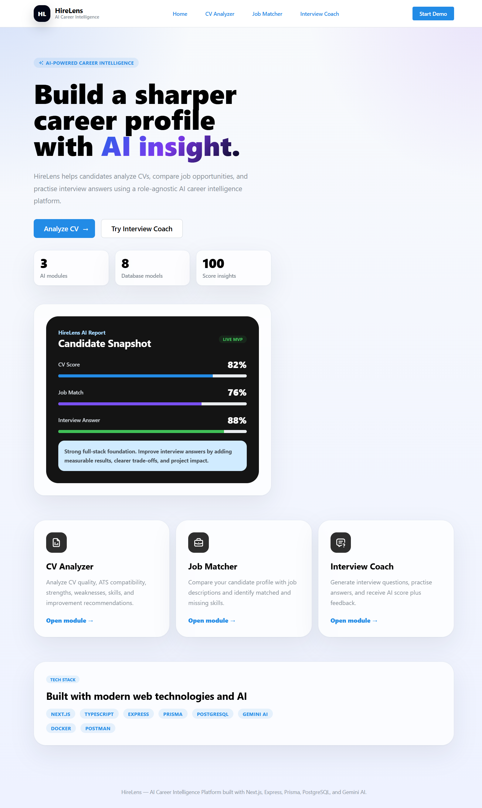
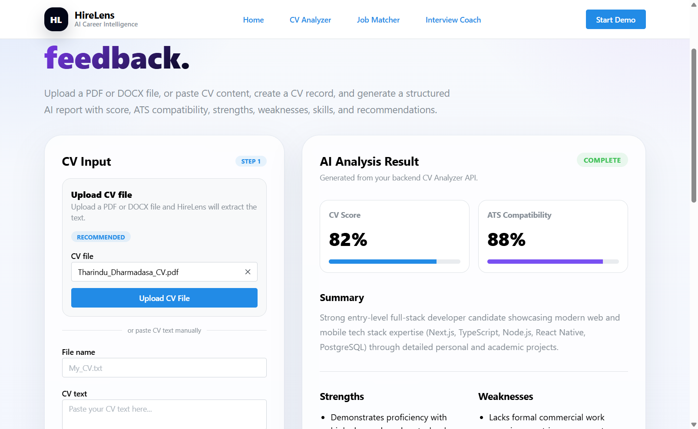
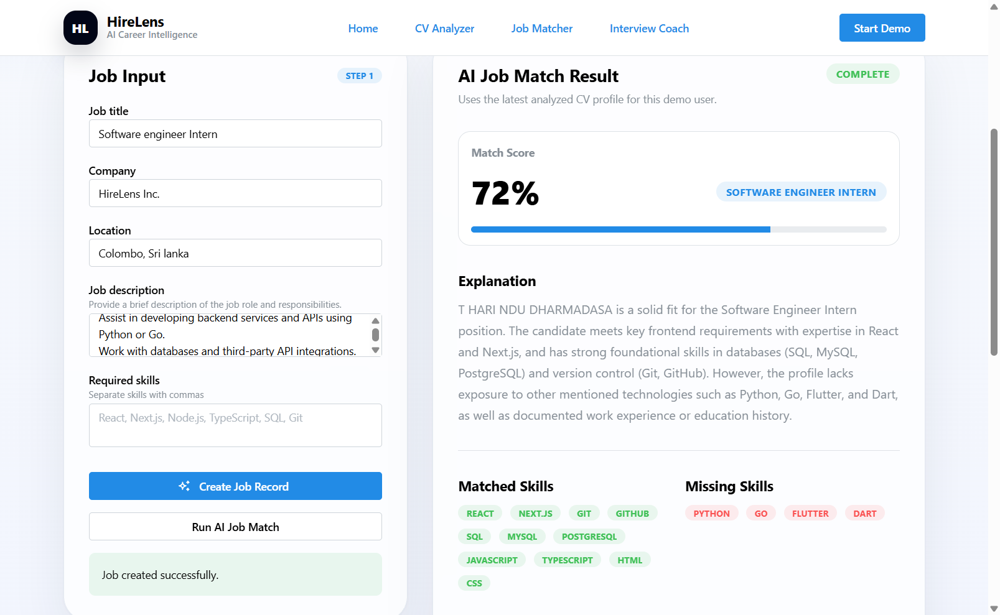
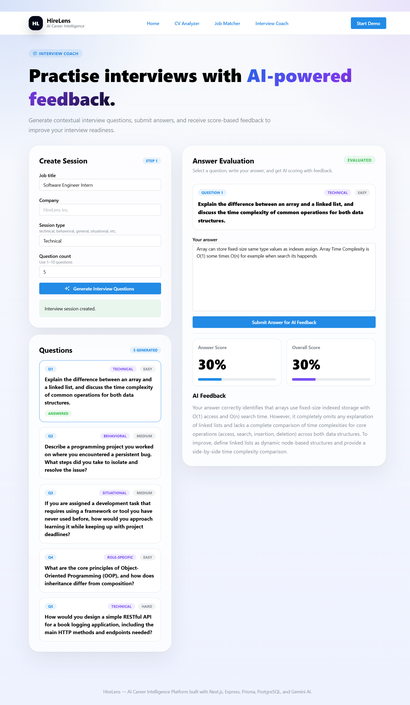

# 🚀 HireLens

**AI-Powered Career Intelligence Platform**

HireLens is a professional, role-agnostic AI career intelligence platform that helps candidates analyze their CVs, evaluate job compatibility, and practise interview answers with AI-powered feedback.

The platform is designed to support different professional backgrounds without requiring role-specific database structures.

- **Live application:** [hirelens-web-one.vercel.app](https://hirelens-web-one.vercel.app/)
- **API:** [hirelens-api.vercel.app](https://hirelens-api.vercel.app)
- **Source repository:** [Tharindu-Dharmadasa/Hire-Lens](https://github.com/Tharindu-Dharmadasa/Hire-Lens)

---

## 📌 Project Status

HireLens is a deployed MVP with three AI-assisted career workflows. The frontend and Express API are hosted separately on Vercel, with PostgreSQL hosted on Neon. This status describes the current deployment and does not imply a production-readiness certification.

| Area                   | Status                                  |
| ---------------------- | --------------------------------------- |
| Career modules         | Implemented                             |
| Authentication         | Clerk integration                       |
| Database               | PostgreSQL with Prisma                  |
| AI integration         | Google Gemini                           |
| Frontend / API hosting | Deployed separately on Vercel           |
| Automated backend tests | Vitest checks for health, routing, CORS |
| Local containers       | Docker Compose for PostgreSQL           |

The repository includes a small automated backend test suite and local Docker support. See [Testing](#-testing) for its scope and the historical manual verification results reported for the deployed MVP.

---

## ✨ Key Features

### CV Analyzer

- Upload PDF or DOCX files (up to 5 MB) and extract their text
- Analyze CV content with Gemini AI
- Return a structured analysis with a score, strengths, weaknesses, ATS compatibility, and improvement recommendations
- Create and manage CV records and associated candidate profile data

### AI Job Matcher

- Create job records and compare job requirements with a candidate profile
- Return a match score, explanation, matching skills, and skill gaps
- Match using a selected CV or the user's latest CV
- Save match results, with one result per user and job

### AI Interview Coach

- Generate questions for an interview session based on the provided role and session context
- Submit answers for AI evaluation
- Receive answer scores and feedback, with an overall session score
- Update an answer for an existing question

### Backend Reliability

- Gemini retry handling
- Fallback model support
- Clean error handling for temporary AI overload
- Authenticated user ownership enforcement

---

## 📸 Screenshots

### Landing Page



### CV Analyzer



### AI Job Matcher



### AI Interview Coach



---

## 🧠 AI Capabilities

HireLens uses Google Gemini through a centralized backend AI service.

The AI modules provide:

- CV score and CV improvement feedback
- Professional summary, strengths, weaknesses, and recommendations
- ATS compatibility score
- Job match score with matched and missing skills
- Interview questions based on role/session type
- Interview answer scores and feedback
- Overall interview session score

CV parsing also creates structured candidate profile data used by the job matcher.

---

## 🏗️ Architecture

HireLens follows a modular monolith architecture.

```text
Browser
   │
   ├── Next.js + React frontend (Vercel)
   │       │
   │       ├── Clerk authentication
   │       └── REST API requests
   │               │
   │               ▼
   └────── Express.js + TypeScript API (Vercel)
                   ├── Prisma ORM ── PostgreSQL (Neon)
                   └── Google Gemini
```

The backend is organized by feature modules, with routes, controllers, services, validators, middleware, and shared types. For local development, the frontend and API use ports 3000 and 3001, and Docker Compose can run PostgreSQL.

---

## 🛠️ Tech Stack

| Layer | Technology |
| --- | --- |
| Frontend | Next.js, React, TypeScript, Mantine UI |
| Backend | Node.js, Express.js, TypeScript |
| Database | PostgreSQL (Neon for the deployed database; PostgreSQL 16 in local Docker setup) |
| ORM | Prisma ORM |
| AI | Google Gemini |
| Authentication | Clerk |
| API style | REST |
| Hosting | Vercel frontend and separately hosted Vercel Express API |
| Local containers | Docker, Docker Compose |
| Testing | Vitest backend checks, TypeScript checks, and reported manual verification |

---

## 📁 Project Structure

```text
hire-lens/
├── backend/
│   ├── src/
│   │   ├── generated/
│   │   │   └── prisma/
│   │   ├── config/
│   │   ├── controllers/
│   │   ├── database/
│   │   ├── middleware/
│   │   ├── routes/
│   │   ├── services/
│   │   │   ├── ai/
│   │   │   ├── cv/
│   │   │   ├── jobs/
│   │   │   ├── matching/
│   │   │   └── interview/
│   │   ├── types/
│   │   ├── validators/
│   │   ├── app.ts
│   │   └── server.ts
│   ├── Dockerfile
│   ├── package.json
│   └── tsconfig.json
│
├── frontend/
│   ├── src/
│   ├── .env.example
│   ├── package.json
│   └── tsconfig.json
│
├── prisma/
│   ├── schema.prisma
│   └── migrations/
│
├── generated/
│   └── prisma/
├── docs/
├── postman/
├── docker-compose.yml
├── prisma.config.ts
├── .env.example
├── .env.docker.example
└── README.md
```

---

## 🗄️ Database Design

HireLens uses eight core database models:

```text
User
 ├── CV
 │    └── CandidateProfile
 │
 ├── JobMatch
 │    └── Job
 │
 └── InterviewSession
      └── InterviewQuestion
           └── InterviewAnswer
```

### Core Models

1. User
2. CV
3. CandidateProfile
4. Job
5. JobMatch
6. InterviewSession
7. InterviewQuestion
8. InterviewAnswer

The database design intentionally avoids creating separate tables for every AI-generated concept. Flexible AI-generated information is stored using structured JSON where appropriate.

---

## 🔐 Authentication and Ownership

HireLens uses Clerk for sign-in. The frontend obtains a Clerk session token and sends it with API requests. After sign-in, the frontend calls the authenticated `POST /api/users/sync` endpoint. The backend reads the Clerk identity from the authenticated request and creates or updates the corresponding local user record using the Clerk user ID and primary email.

Protected CV, job, matching, and interview routes use backend middleware to resolve the authenticated Clerk identity to the internal database user ID. Services use that server-derived ID to scope CVs, match results, interview sessions, and per-user match data. Job routes also require authentication; job records themselves are not directly associated with a user in the current schema. Feature requests do not use client-provided `userId` values for authentication or ownership.

---

## 📚 API Overview

Local API base URL:

```text
http://localhost:3001
```

API prefix:

```text
/api
```

### Health and user synchronization

```text
GET /api/health
POST /api/users/sync
```

The health endpoint is public. User synchronization requires a Clerk-authenticated request.

### Protected feature routes

```text
CVs:        /api/cvs, /api/cvs/upload, /api/cvs/:id, /api/cvs/:id/analyze
Jobs:       /api/jobs, /api/jobs/:id
Matches:    /api/jobs/:id/match, /api/matches, /api/matches/:id
Interviews: /api/interviews, /api/interviews/:id,
            /api/interviews/:id/questions/:questionId/answer
```

These routes require Clerk authentication; ownership is resolved by the backend. For detailed request and response examples, see [API documentation](docs/api-documentation.md). That separate reference is older than the current authentication flow and should be reviewed before relying on its authentication examples.

---

## 🧪 Testing

The backend uses Vitest. The current automated test file covers the root response, the health endpoint, not-found routing, and allowed-origin CORS behavior. This is a focused test suite, not comprehensive integration coverage.

Run the backend test suite from the repository root:

```bash
npm test
```

Run TypeScript checks and the repository build:

```bash
npm run type-check --workspace=backend
npm run type-check --workspace=frontend
npm run build
```

For interactive backend test runs, use `npm run test:watch` from `backend/`.

### Reported historical verification

The following results were previously reported for the MVP; they are not a guarantee of current behavior or performance:

- **Vitest:** 4/4 checks passed, covering health, routing, and CORS behavior.
- **Deployed manual checks:** all three AI modules, PDF and DOCX uploads, multi-user authentication and data workflows, and mobile navigation.
- **Lighthouse audit:** desktop Performance 99/100 and mobile Performance 77/100. The audit date and supporting report were not included here.

The Postman collection is available at [postman/HireLens.postman_collection.json](postman/HireLens.postman_collection.json). Its request setup should use Clerk authentication rather than legacy client-provided user IDs.

---

## 🤖 AI Reliability Handling

Gemini may occasionally return temporary overload or rate-limit errors.

HireLens handles retryable AI errors such as:

- `429 RESOURCE_EXHAUSTED`
- `503 UNAVAILABLE`
- temporary high-demand errors
- temporary model unavailable errors

The backend uses:

- Retry handling
- Exponential backoff
- Fallback model support
- Clean API error responses

If Gemini remains unavailable, the backend returns a clean API error response instead of crashing the server.

---

## 🚀 Quick Start

### Prerequisites

Install:

- Node.js 20+
- npm
- Docker
- Docker Compose (for local PostgreSQL)
- Clerk credentials and a Gemini API key for authenticated AI workflows

---

### 1. Clone and install

```bash
git clone https://github.com/Tharindu-Dharmadasa/Hire-Lens.git
cd hire-lens
npm install
```

---

### 2. Start local PostgreSQL (optional)

```bash
docker compose up -d
```

Check running containers:

```bash
docker compose ps
```

---

### 3. Configure environment variables

Create a root `.env` for the backend and Prisma CLI. Set the database URLs to match your local database or Neon. For local Docker PostgreSQL, use the local connection settings in `docker-compose.yml`; those Compose defaults are for development only.

```env
NODE_ENV=development
PORT=3001
DATABASE_URL=postgresql://<user>:<password>@localhost:5432/<database>?schema=public
DIRECT_URL=postgresql://<user>:<password>@localhost:5432/<database>?schema=public
CORS_ORIGIN=http://localhost:3000
CLERK_SECRET_KEY=your_clerk_secret_key
GEMINI_API_KEY=your_gemini_api_key
GEMINI_MODEL=your_gemini_model
GEMINI_FALLBACK_MODEL=your_fallback_gemini_model
```

Create `frontend/.env.local`:

```env
NEXT_PUBLIC_API_BASE_URL=http://localhost:3001/api
NEXT_PUBLIC_CLERK_PUBLISHABLE_KEY=your_clerk_publishable_key
CLERK_SECRET_KEY=your_clerk_secret_key
```

The frontend reads `NEXT_PUBLIC_API_BASE_URL` and `NEXT_PUBLIC_CLERK_PUBLISHABLE_KEY`; Clerk server-side configuration and the backend use `CLERK_SECRET_KEY`. The checked-in root `.env.example` contains legacy frontend API and Clerk publishable-key names; use the runtime variable names shown above. Keep real credentials in local environment files and never commit them.

---

### 4. Generate and validate Prisma client/schema

From the repository root:

```bash
npx prisma generate
npx prisma validate
npx prisma migrate status
```

The backend imports its runtime Prisma client from `backend/src/generated/prisma`, which is also the generator output in `prisma/schema.prisma`. The root Prisma config additionally declares `generated/prisma` as a client output. Prisma commands require `DIRECT_URL`. The migration status command checks the configured database; it does not apply migrations.

Do not use `prisma migrate reset` on an existing development database unless you intentionally want to delete all development data.

---

### 5. Start the backend

From the repository root:

```bash
npm run dev --workspace=backend
```

Backend runs at:

```text
http://localhost:3001
```

Health check:

```text
http://localhost:3001/api/health
```

---

### 6. Start the frontend

In a separate terminal from the repository root:

```bash
npm run dev --workspace=frontend
```

Frontend runs at:

```text
http://localhost:3000
```

---

## 🐳 Docker

Docker Compose starts PostgreSQL for local development:

```bash
docker compose up -d
docker compose ps
```

Build the backend image from the repository root:

```bash
docker build -f backend/Dockerfile -t hirelens-backend .
```

To run the backend image locally, create a private `.env.docker` based on `.env.docker.example` and attach the container to the Docker Compose network so it can reach the `postgres` service:

```bash
docker network ls
docker run --rm -p 3001:3001 --env-file .env.docker --network YOUR_COMPOSE_NETWORK hirelens-backend
```

Replace `YOUR_COMPOSE_NETWORK` with the network name reported by Docker.

The Dockerfile copies `backend/src` (including its generated Prisma client) into the builder and copies the root `generated/` directory separately. It does not run `prisma generate` during the image build. Although these instructions match the current Dockerfile, the Docker image build and runtime have not been independently validated as part of this README review.

---

## ☁️ Deployment

The current deployed setup is:

- **Frontend:** Next.js application hosted on Vercel.
- **API:** Express.js service hosted separately on Vercel.
- **Database:** PostgreSQL hosted on Neon.
- **AI:** Google Gemini.
- **Authentication:** Clerk.

The Vercel frontend and API are separate deployments. Docker is retained for local development and is not the current hosting arrangement.

---

## 📊 Development Database

The local Compose service uses the `postgres:16-alpine` image and exposes PostgreSQL on port `5432`. The service name inside the Compose network is `postgres`. Compose contains fixed development-only database defaults; do not reuse them outside local development.

---

## 🔄 Development Workflow

Recommended local development setup:

```text
Terminal 1
──────────
docker compose up -d

Terminal 2
──────────
npm run dev --workspace=backend

Terminal 3
──────────
npm run dev --workspace=frontend
```

Then open:

```text
http://localhost:3000
```

---

## 📖 Documentation

| Document | Description |
| --- | --- |
| [docs/project-specification.md](docs/project-specification.md) | Project requirements |
| [docs/architecture.md](docs/architecture.md) | System architecture |
| [docs/database-design.md](docs/database-design.md) | Database schema and relationships |
| [docs/api-documentation.md](docs/api-documentation.md) | REST API reference; authentication examples need review |
| [docs/testing.md](docs/testing.md) | Testing strategy; reflects earlier test status |
| [docs/DEVELOPMENT-STATUS.md](docs/DEVELOPMENT-STATUS.md) | Development progress; reflects earlier MVP/auth status |

The documentation links above are retained, but the architecture, API, testing, and development-status documents include claims from an earlier development stage. They were not changed as part of this README-only update.

---

## 👤 Author

**Tharindu Dharmadasa**  
Software Engineering Graduate  
Sri Lanka

---

## 📌 Project Summary

| Area | Details |
| --- | --- |
| Project | HireLens |
| Architecture | Modular monolith |
| Backend | Express.js + TypeScript, hosted on Vercel |
| Frontend | Next.js + TypeScript, hosted on Vercel |
| Database | PostgreSQL on Neon, accessed with Prisma |
| AI | Google Gemini |
| Authentication | Clerk |
| Local development | Docker Compose |
| API style | REST |
| Status | Deployed MVP; not a production-readiness claim |
